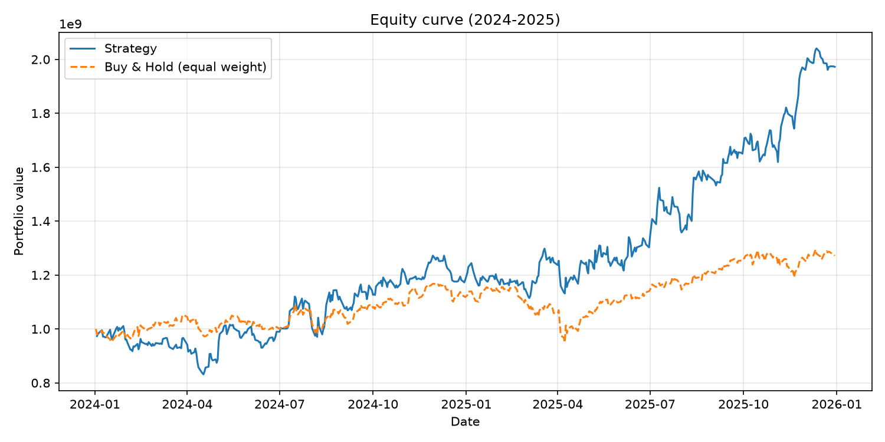
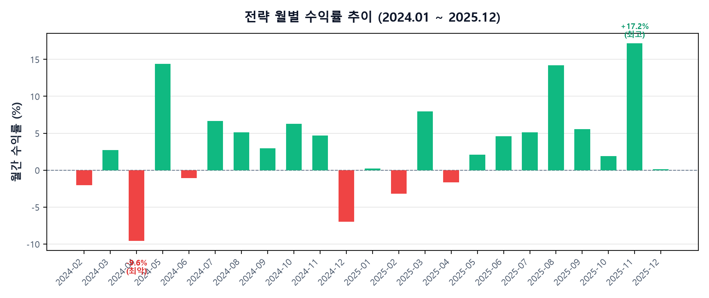

# AI퀀트 — 미국주식 리밸런싱 백테스트


2주 리밸런싱 퀀트 전략을 2023년 실험으로 고르고 2024~2025년으로 검증하는 연구용 백테스트 시스템.
전략은 사람이 짜고, 데이터·엔진·지표·리포트는 이 환경이 담당한다.

## 대표 결과 (K안, 2024-01-01 ~ 2025-12-31)

| 지표 | 전략 | Buy & Hold (균등비중) |
|---|---|---|
| CAGR | **42.6%** | 13.0%/년 환산 |
| 2년 총수익률 | **+103.3%** | +27.2% |
| 초과수익 | **+75.4pp** | — |
| MDD | -17.8% | — |
| Sharpe / Sortino | 1.39 / 2.32 | — |

유니버스 3,175종목(NASDAQ 유동성 필터), 시드 10억, 편도 수수료 0.1%. 산출물은 [result/](result/) 참조.




## 전략 (K안 v2.5)

- **바구니**: 스윙 50% + 단기 40% + 현금 10% (리밸런싱 시 현금 10% 강제)
- **스윙**: PER+PBR 상위 9개 각 10%, 2주 리밸런싱
- **단기**: RSI(14) 매수 <20 / 매도 >70, 쿨다운 10일, 리밸런싱 밴드 0.02
- **손절**: 평단 대비 -10% 전량 매도 (밸류트랩 차단)
- **H&S 규칙**: 상승추세 보유종목은 리밸런싱 강제매도 면제

2023년 풀 스위프 11안 중 양 기간 모두 B&H를 이긴 유일안. 2023년 1위였던 매도-70안과 BB 단기형은
본선에서 붕괴해 과적합으로 탈락했다. 상세 기록은 [prompts/AI프롬프트모음.md](prompts/AI프롬프트모음.md) S1.

## 빠른 시작

```powershell
py -m venv .venv
.\.venv\Scripts\Activate.ps1
.\.venv\Scripts\python.exe -m pip install -r requirements.txt

# 본 백테스트 (풀 3175종목, 디스크 캐시 사용)
.\.venv\Scripts\python.exe run_backtest.py --universe pool --mode final

# 2023년 실험 + 지표 교체 + 파라미터 오버라이드 예시
.\.venv\Scripts\python.exe run_backtest.py --universe pool --mode experiment --signal bb
.\.venv\Scripts\python.exe run_backtest.py --universe pool --mode experiment --set strategy.short.rsi_sell=70

# 회귀테스트 (38개)
.\.venv\Scripts\python.exe -m unittest discover -s tests
```

풀 시세 최초 수집만 온라인이 필요하다 (`tools/build_pool.py`, EDGAR·yfinance·NASDAQ 무료 소스).

## 저장소 구조

```text
AI퀀트/
├── run_backtest.py        # 엔트리포인트 (설정→데이터→백테스트→리포트)
├── config.yaml            # 전략·비용·기간 설정 (현재 K안)
├── src/                   # 엔진(backtest) · 지표 · 전략 플러그인 · 리포트
│   └── strategies/my_strategy.py   # 본 전략
├── tests/                 # 회귀테스트 38개
├── tools/build_pool.py    # 전종목 풀 수집 (체크포인트 재개 지원)
├── prompts/               # AI 프롬프트 모음 (시스템 P + 전략 S, 제출물 2-1)
├── data/                  # 풀 명단·매핑 (대용량 시세는 git 제외, 재수집 가능)
├── result/                # K안 본선 산출물 (제출용)
└── outputs_archive/       # 실험 과정 기록 34건 (git 제외)
```

## 산출물 (매 실행 자동 생성)

`trade_log.csv`, `daily_holdings.csv`(매일 보유·평단·수익률),
`discovery.csv`(종목별 손익표), `trade_history_view.csv`(거래 한눈보기, 한글 헤더),
`daily_equity.csv`, `metrics.json`(교차검증 포함), `analysis.md`(자동 평가),
`equity_curve.png`, `report.pptx`, `report.xlsx`.

## 시간 기준선 (필수)

전략 설계는 2023-12-31까지의 데이터만 보고 정하고, 2024~2025 구간은 오직 평가용이다
(뒷북 금지). 펀더멘털은 공시일 기준 확정치(filed≤컷오프)만 사용한다. 상세 지침은
[prompts/AI프롬프트모음.md](prompts/AI프롬프트모음.md) P0.

## 한계 (제출 전 확인)

- 손절 10% 레벨 민감도가 가파름 (15%·20%는 2023년 탈락) — 과적합 주의 항목
- EBS 한 종목 편중 (본선 기여 +2.3억), 회전율 75배·수수료 약 9,400만원
- EDGAR 확정치 1450/3175 확보, 결측 최하위. 수동 FY2023 파일 기입 시 정확도 상승
- 상장폐지 꼬리는 최종가 평탄화 가정 (미래정보 미사용)

## AI 활용

Muse Code(Muse Spark)로 엔진·리포트를 생성하고 실험을 설계했다.
주고받은 프롬프트는 [prompts/](prompts/)에 시스템(P)·전략(S) 합본으로 보관한다.
